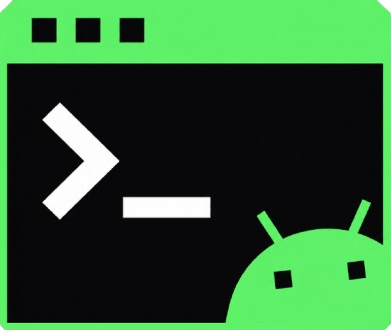

<a id="readme-top"></a>

<p align="center">
  <a href="README.md">English</a>
</p>

[![Katkıda Bulunanlar][contributors-shield]][contributors-url]
[![Fork'lar][forks-shield]][forks-url]
[![Yıldızlar][stars-shield]][stars-url]
[![Sorunlar][issues-shield]][issues-url]
[![Lisans][license-shield]][license-url]


<br />
<div align="center">
  <a href="https://github.com/aybrkaknc/EasyADB">
    
  </a>

  <h3 align="center">EasyADB</h3>

  <p align="center">
    ADB komutu yazmadan Android cihazları ADB üzerinden yedeklemek, geri yüklemek, gereksiz uygulamalardan arındırmak ve yönetmek için Windows masaüstü uygulaması.
    <br />
    <a href="https://github.com/aybrkaknc/EasyADB/releases">İndir</a>
    |
    <a href="https://github.com/aybrkaknc/EasyADB/issues/new?template=bug_report.md">Hata Bildir</a>
    |
    <a href="https://github.com/aybrkaknc/EasyADB/issues/new?template=feature_request.md">Özellik İste</a>
  </p>
</div>


<details>
  <summary>İçindekiler</summary>
  <ol>
    <li>
      <a href="#proje-hakkında">Proje Hakkında</a>
      <ul>
        <li><a href="#özellikler">Özellikler</a></li>
        <li><a href="#kullanılan-teknolojiler">Kullanılan Teknolojiler</a></li>
      </ul>
    </li>
    <li>
      <a href="#başlarken">Başlarken</a>
      <ul>
        <li><a href="#kurulum-paketi">Kurulum Paketi</a></li>
        <li><a href="#gereksinimler">Gereksinimler</a></li>
        <li><a href="#kaynaktan-kurulum">Kaynaktan Kurulum</a></li>
      </ul>
    </li>
    <li><a href="#kullanım">Kullanım</a></li>
    <li><a href="#geliştirme">Geliştirme</a></li>
    <li><a href="#yol-haritası">Yol Haritası</a></li>
    <li><a href="#katkıda-bulunma">Katkıda Bulunma</a></li>
    <li><a href="#lisans">Lisans</a></li>
    <li><a href="#iletişim">İletişim</a></li>
    <li><a href="#teşekkürler">Teşekkürler</a></li>
  </ol>
</details>


## Proje Hakkında

ROM değiştirmek genellikle önce telefona yedek almak, sonra büyük dosyaları bilgisayara kopyalamak demektir. EasyADB uygulamaları ADB üzerinden doğrudan bilgisayara yedekler ve yeni bir ROM'dan sonra geri yükler. ADB'yi kendi içinde getirir, ayrıca bir şey kurmanız gerekmez.

### Ekran Görüntüleri

Ekran görüntüleri bir sonraki sürümle eklenecek.

### Özellikler

* **Birden fazla cihaz:** USB ve Wi-Fi cihazları aynı anda, cihaz seçici ve yetkisiz ya da çevrimdışı cihazlar için adım adım yardım.
* **Yedekleme ve geri yükleme:** APK ve bölünmüş APK'lar, OBB dosyaları ve root varsa uygulama verisi. Yedekler sürümlü bir manifest ve SHA-256 sağlama toplamlarıyla düz klasörlerdir, bu yüzden geri yükleme hızlıdır. Çalışma zamanı izinleri de kaydedilir ve geri yüklerken isteğe bağlı olarak tekrar verilir. Root yoksa yalnızca uygulama geri yüklenir ve verinin atlandığı size söylenir. Birden fazla yedeği seçip tek seferde geri yükleyebilirsiniz. Tek bir `.easybckp` dosyası olarak dışa veya içe aktarma.
* **Doğrudan PC'ye:** Uygulamaları ve klasörleri telefonda yer kaplamadan bu bilgisayara akıtın, telefondaki EasyAndroid'den mesaj, arama kaydı, duvar kâğıdı ve sistem ayarı yedeklerini isteyin, telefonun yedekleri kendisinin başlatmasına izin verin. Her iş gerektiğinde sorulur, ilerlemesini ve nasıl bittiğini gösterir. Telefona bir kez güvenilir ve Ayarlar'dan geri alınır. Telefondaki kopyalar yalnızca PC kopyası doğrulandıktan ve siz onayladıktan sonra silinir.
* **Debloater:** UAD-NG listesinden paket açıklamaları ve güvenlik seviyeleri, toplu devre dışı bırakma, etkinleştirme, kaldırma ve geri getirme, yeni bir ROM'dan sonra tekrar uygulanabilen profiller.
* **Kablosuz hata ayıklama:** Eşleştirme kodu, QR kod, elle IP ve eski cihazlar için `adb tcpip`. Kayıtlı cihazlar tek tıkla yeniden bağlanır.
* **Terminal:** adb ve fastboot komutlarını canlı çıktı, geçmiş, tamamlama ve iptal ile çalıştırır.
* **Dosyalar:** Cihaza göz atma, oluşturma, yeniden adlandırma, taşıma ve silme, bilgisayar ile cihaz arasında dosya kopyalama.
* **Logcat:** Seviye ve etiket filtreli canlı günlük, vurgulamalı regex arama, dosyaya kaydetme ve dışa aktarma.
* **Performans:** Canlı CPU, RAM, pil ve depolama, donanım bilgileri ve ağ ayrıntıları.
* **Kurulum ve yeniden başlatma:** APK kurma, ZIP sideload ve sistem, kurtarma, önyükleyici, sideload veya fastbootd moduna yeniden başlatma.
* **Kolaylık:** İngilizce ve Türkçe, klavye kısayolları, tepsi simgesi, Windows bildirimleri ve geri alınamaz işlemler için onay.

<p align="right">(<a href="#readme-top">başa dön</a>)</p>


### Kullanılan Teknolojiler

[![Tauri][tauri-shield]][tauri-url]
[![Rust][rust-shield]][rust-url]
[![React][react-shield]][react-url]
[![TypeScript][typescript-shield]][typescript-url]
[![Vite][vite-shield]][vite-url]
[![Tailwind CSS][tailwind-shield]][tailwind-url]

<p align="right">(<a href="#readme-top">başa dön</a>)</p>


## Başlarken

### Kurulum Paketi

En son `.msi` dosyasını [Releases](https://github.com/aybrkaknc/EasyADB/releases) sayfasından indirin. Kurulum İngilizce ve Türkçe olarak sunulur ve eksikse WebView2'yi kurar.

### Gereksinimler

Windows 10 veya 11 (x64) üzerinde kaynaktan derlemek için:

* Node.js (LTS)
  ```sh
  winget install OpenJS.NodeJS.LTS
  ```
* Rust (stable)
  ```sh
  winget install Rustlang.Rustup
  ```
* C++ iş yüküyle Visual Studio Build Tools
  ```sh
  winget install Microsoft.VisualStudio.2022.BuildTools --override "--wait --passive --add Microsoft.VisualStudio.Workload.VCTools --includeRecommended"
  ```

### Kaynaktan Kurulum

1. Depoyu klonlayın
   ```sh
   git clone https://github.com/aybrkaknc/EasyADB.git
   cd EasyADB
   ```
2. NPM paketlerini kurun
   ```sh
   npm install
   ```
3. Uygulamayı başlatın. İlk çalıştırma, sabit sürümlü ve SHA-256 ile doğrulanmış Android platform-tools kopyasını `src-tauri/binaries` içine indirir.
   ```sh
   npm run tauri dev
   ```
4. Kurulum paketini derleyin (isteğe bağlı). `.msi` dosyası `src-tauri/target/release/bundle/msi` içine yazılır.
   ```sh
   npm run tauri build
   ```

`src-tauri` içindeki `cargo` komutları da bu dosyalara ihtiyaç duyar. Kullanmadan önce bir kez `npm run adb:fetch` çalıştırın.

<p align="right">(<a href="#readme-top">başa dön</a>)</p>


## Kullanım

1. Telefonda Geliştirici seçeneklerini ve USB hata ayıklamayı açın, telefonu bağlayın ve yetki isteğini onaylayın.
2. Üstteki seçiciden cihazı seçin. Tüm modüller seçili cihaz üzerinde çalışır.
3. Modül değiştirmek için simge çubuğunu veya `Ctrl+1` ile `Ctrl+9` arasını kullanın. `F5` yeniler, `Ctrl+F` arama kutusuna odaklanır.

Yedekler varsayılan olarak `Belgeler\EasyADB\Backups` klasörüne kaydedilir. Klasörü Ayarlar'dan değiştirebilirsiniz.

_Sistem paketlerini kaldırmak cihazınızın çalışmamasına neden olabilir. Kaldırmadan önce her paketin güvenlik seviyesini okuyun. Kaldırılan paketler Debloat modülünden geri getirilebilir._

<p align="right">(<a href="#readme-top">başa dön</a>)</p>


## Geliştirme

```
src-tauri/src/
  adb/        tek adb istemcisi, kabuk tırnaklama, ortak ayrıştırıcılar
  features/   her özellik için bir modül: komutlar ve mantık
  lib.rs      eklenti kurulumu ve komut kaydı
src/
  app/        kabuk, durum deposu, i18n
  features/   her modül ekranı için bir klasör
  shared/     hook'lar, UI bileşenleri, yardımcılar
  bindings.ts tauri-specta ile Rust'tan üretilir
e2e/          sahte arka uca karşı Playwright testleri
```

| Komut | Amaç |
| --- | --- |
| `npm run lint` | ESLint |
| `npm run format` | Prettier |
| `npm test` | Vitest birim ve bileşen testleri |
| `npm run test:e2e` | Playwright uçtan uca testleri (bir kez `npx playwright install chromium`) |
| `npm run test:rust` | Rust birim testleri; `src/bindings.ts` dosyasını da yeniden üretir |
| `npm run test:all` | Yukarıdaki tüm testler |

Tasarım ayrıntıları için [docs/specs/ARCHITECTURE.md](docs/specs/ARCHITECTURE.md) dosyasına bakın.

<p align="right">(<a href="#readme-top">başa dön</a>)</p>


## Yol Haritası

- [x] v0.2.0: yukarıdaki özelliklerle yeniden yazım
- [ ] Dosya yöneticisinde sürükle-bırak ile yükleme
- [ ] Resim ve APK önizlemeleri
- [ ] Logcat'te uygulama veya PID filtresi
- [ ] Bölünmüş ve çoklu APK kurma
- [ ] Yüksek kontrast modu

Önerilen özelliklerin ve bilinen sorunların tam listesi için [açık sorunlara](https://github.com/aybrkaknc/EasyADB/issues) bakın.

<p align="right">(<a href="#readme-top">başa dön</a>)</p>


## Katkıda Bulunma

Katkılarınızı memnuniyetle karşılıyoruz. Pull request açmadan önce [CONTRIBUTING.tr.md](CONTRIBUTING.tr.md) dosyasını okuyun. Güvenlik sorunlarını [SECURITY.md](SECURITY.md) dosyasında anlatıldığı gibi bildirin.

<p align="right">(<a href="#readme-top">başa dön</a>)</p>


## Lisans

GNU General Public License v3.0 ile dağıtılır. Ayrıntılar için [LICENSE](LICENSE) dosyasına bakın.

EasyADB şunları içerir:
* [Android SDK Platform-Tools](https://developer.android.com/tools/releases/platform-tools), Apache License 2.0. Bildirim dosyası `licenses/platform-tools-NOTICE.txt` olarak kurulur.
* [Universal Android Debloater Next Generation](https://github.com/Universal-Debloater-Alliance/universal-android-debloater-next-generation) paket verileri, GPL-3.0.

<p align="right">(<a href="#readme-top">başa dön</a>)</p>


## İletişim

Ayberk - [@aybrkaknc](https://github.com/aybrkaknc)

Proje Bağlantısı: [https://github.com/aybrkaknc/EasyADB](https://github.com/aybrkaknc/EasyADB)

<p align="right">(<a href="#readme-top">başa dön</a>)</p>


## Teşekkürler

* [Best-README-Template](https://github.com/othneildrew/Best-README-Template) - othneildrew
* [Universal Android Debloater Next Generation](https://github.com/Universal-Debloater-Alliance/universal-android-debloater-next-generation)
* [Tauri](https://tauri.app/), [tauri-specta](https://github.com/specta-rs/tauri-specta), [Radix](https://www.radix-ui.com/) ve [TanStack Query](https://tanstack.com/query)

<p align="right">(<a href="#readme-top">başa dön</a>)</p>


<!-- MARKDOWN LINKS AND IMAGES -->
[contributors-shield]: https://img.shields.io/github/contributors/aybrkaknc/EasyADB.svg?style=for-the-badge
[contributors-url]: https://github.com/aybrkaknc/EasyADB/graphs/contributors
[forks-shield]: https://img.shields.io/github/forks/aybrkaknc/EasyADB.svg?style=for-the-badge
[forks-url]: https://github.com/aybrkaknc/EasyADB/network/members
[stars-shield]: https://img.shields.io/github/stars/aybrkaknc/EasyADB.svg?style=for-the-badge
[stars-url]: https://github.com/aybrkaknc/EasyADB/stargazers
[issues-shield]: https://img.shields.io/github/issues/aybrkaknc/EasyADB.svg?style=for-the-badge
[issues-url]: https://github.com/aybrkaknc/EasyADB/issues
[license-shield]: https://img.shields.io/github/license/aybrkaknc/EasyADB.svg?style=for-the-badge
[license-url]: https://github.com/aybrkaknc/EasyADB/blob/main/LICENSE
[tauri-shield]: https://img.shields.io/badge/Tauri_2-24C8DB?style=for-the-badge&logo=tauri&logoColor=white
[tauri-url]: https://tauri.app/
[rust-shield]: https://img.shields.io/badge/Rust-000000?style=for-the-badge&logo=rust&logoColor=white
[rust-url]: https://www.rust-lang.org/
[react-shield]: https://img.shields.io/badge/React_19-20232A?style=for-the-badge&logo=react&logoColor=61DAFB
[react-url]: https://react.dev/
[typescript-shield]: https://img.shields.io/badge/TypeScript-3178C6?style=for-the-badge&logo=typescript&logoColor=white
[typescript-url]: https://www.typescriptlang.org/
[vite-shield]: https://img.shields.io/badge/Vite-646CFF?style=for-the-badge&logo=vite&logoColor=white
[vite-url]: https://vitejs.dev/
[tailwind-shield]: https://img.shields.io/badge/Tailwind_CSS_4-06B6D4?style=for-the-badge&logo=tailwindcss&logoColor=white
[tailwind-url]: https://tailwindcss.com/
